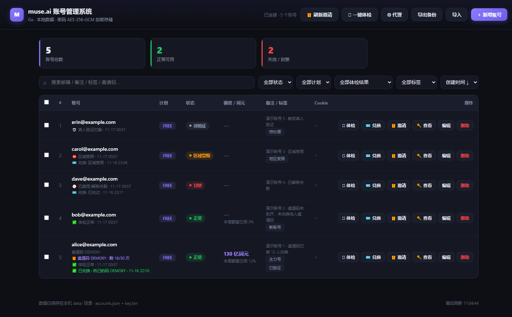
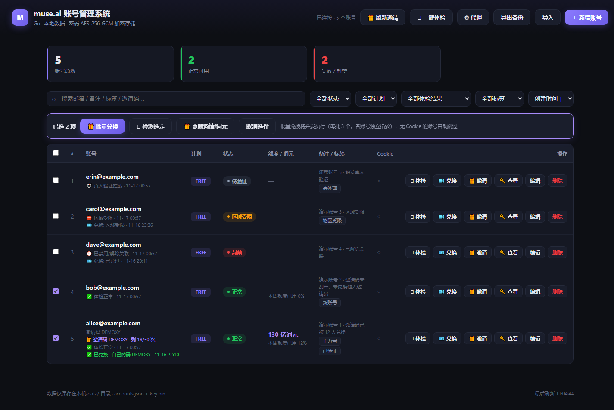
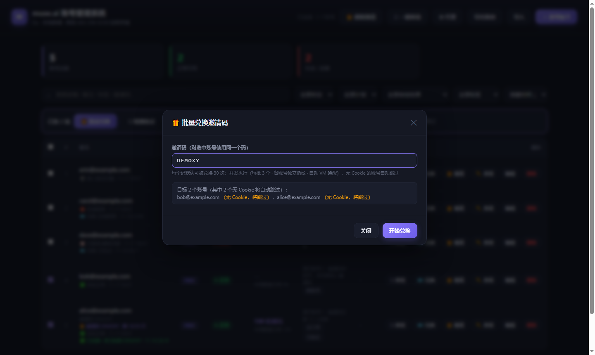
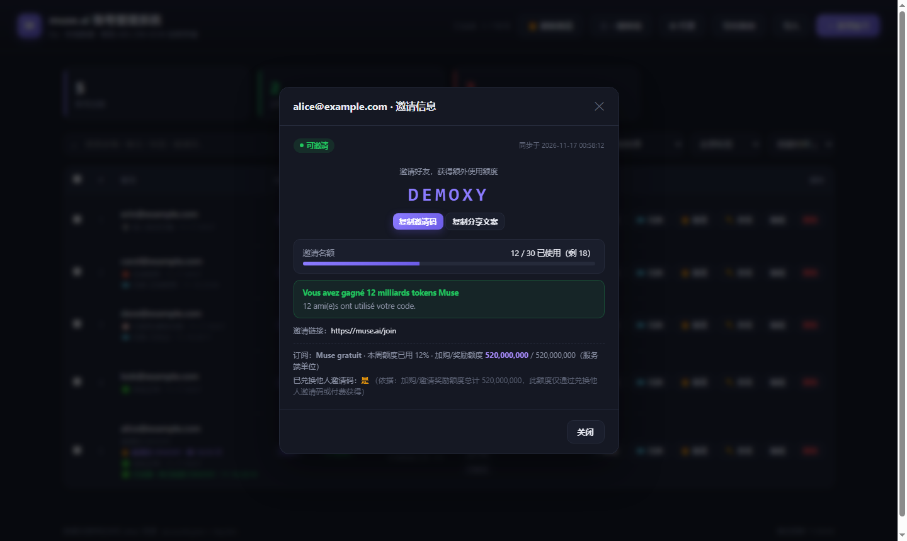
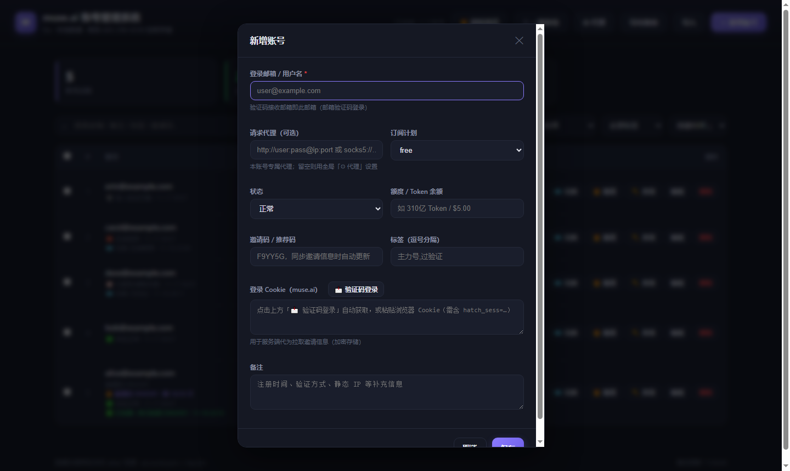

# muse-account-manager

A locally-run web tool for managing muse.ai accounts — a single Go binary with zero third-party dependencies.

Email-code login for multiple accounts, encrypted cookie storage, account admission health checks, invite-code scratching / batch redemption, and subscription quota (token) tracking — everything happens **on your own machine**; no data is ever uploaded to any third party.

**AFF MUSE invitation code Enter during registration to get 1 billion words tokens**
EZNCZT<br>
6XNGZL<br>
MYLMEO<br>
ZCT7ZR<br>
IV9ST1<br>
A4L5EO<br>
9TPZTU<br>
EXH6W3<br>

[中文](README.md) · **English**

> ⚠️ This tool is intended for personal management of your own accounts only. Please comply with the muse.ai Terms of Service; mass sign-ups, risk-control evasion and other abuse are outside this tool's design goals.

## Features

- **Account registry**: centralized management of email-code login accounts; cookies stored encrypted at rest with AES-256-GCM (master key in `data/key.bin`)
- **Email-code login (server-side)**: enter an email → receive the code → the tool runs the full muse.ai login chain automatically (restart → send-otp → confirm-otp → [select-account] → save-account) and fills in the cookie — no browser needed
- **Account health check (admission status)**: dual signals from `auth/check` + the landing page `vmState`, distinguishing five states:
  - ✅ Normal (admitted · VM RUNNING)
  - 🚫 Disabled / detached (vmState=DISABLED, not exposed by the API layer)
  - ⛔ Region-limited / waitlist (hatchAdmissionInvalidated)
  - 🤖 Human-verification challenge (checkpoint_url)
  - ⌛ Login expired / ⚠️ undetermined
- **Invite codes**:
  - First-time "scratch" is automatic (GET shows the info → POST generates the code / refreshes live counts)
  - Live redemption counts (POST data is authoritative; no stale caching)
  - **Batch redemption**: redeem one code across multiple selected accounts in parallel (3 per batch, unique browser fingerprint per account)
- **Subscription / token tracking**: replicates the site's Server Action to query subscriptions; `topupTotal > 0` is the reliable signal for "has redeemed someone else's code"; the quota column shows tokens directly (1 unit = 25 tokens)
- **One-click operations**: check all / refresh all invites (or only the selected accounts), with summary statistics and per-account details
- **Bilingual UI (Chinese / English)**: one-click 🌐 switch in the top-right corner; the preference is stored in the browser
- **Unique per-account request fingerprint**: UA / sec-ch-ua / Accept-Language derived deterministically from the login email's hash (stable per account, distinct across accounts), avoiding cross-account fingerprint linking
- **Proxy support**: per-account proxy > global setting > `MUSE_PROXY` environment variable; built-in connectivity test
- **Import / export**: JSON backups (encrypted by default; plaintext export available for safekeeping)

## Screenshots

| | |
|:---:|:---:|
| **Account dashboard** | **Multi-select batch operations** |
|  |  |
| **Batch redeem invite codes** | **Invite code details** |
|  |  |

**Add account (email-code login)**



> All demo data shown belongs to fictional accounts.

## Deployment Guide

### 1. Requirements

- Windows 10+ (x64) or Linux x86_64 / arm64 — single binary, no installer, no runtime dependencies
- A modern browser (Chrome / Edge / Firefox)
- A working proxy (HTTP or SOCKS5) to reach muse.ai — direct connections are usually unreachable from mainland China

### 2. Get the program

Download the file for your platform from [Releases](../../releases) into a dedicated folder (the program creates `data/` next to itself automatically):

| File | Platform |
|---|---|
| `muse-manager.exe` | Windows x64 |
| `muse-manager-linux-amd64` | Linux x86_64 |
| `muse-manager-linux-arm64` | Linux arm64 (Raspberry Pi / ARM servers) |

You can also build it yourself (see [Build](#build)).

### 3. Directory layout

```
muse-account-manager/
├── muse-manager.exe        # main program (use the matching binary on Linux)
├── 启动账号管理.bat         # one-click launcher for Windows
└── data/                   # created on first run
    ├── accounts.json       # account store (sensitive fields are AES-256-GCM encrypted)
    ├── key.bin             # master key (auto-generated on first run)
    └── settings.json       # global settings (proxy, etc.)
```

All data lives in the single `data/` directory — copy it to back up, delete it to wipe.

### 4. First run

```bash
# Windows: double-click 启动账号管理.bat, or
muse-manager.exe serve -open

# Linux
chmod +x muse-manager-linux-amd64
./muse-manager-linux-amd64 serve -open
```

`-open` opens the browser automatically, or visit <http://127.0.0.1:8787> manually. Press Ctrl+C to stop.

The service binds to `127.0.0.1` by default (local only). Common flags:

| Flag | Description |
|---|---|
| `-addr` | Listen address, default `127.0.0.1:8787` (use `0.0.0.0:8787` for LAN access — combine with an access token) |
| `-data` | Data directory, default `./data` |
| `-open` | Open the browser after startup |

To require an access token for the web UI:

```bash
# Windows PowerShell
$env:MUSE_ACCESS_TOKEN='your-token'; .\muse-manager.exe serve
# Linux
MUSE_ACCESS_TOKEN=your-token ./muse-manager-linux-amd64 serve
```

### 5. Configure a proxy

Requests to muse.ai (checks / invites / login) need a proxy. Priority: **per-account proxy > global proxy > `MUSE_PROXY` environment variable**.

Recommended: after starting, click "⚙ Proxy" in the top-right corner → enter e.g. `socks5://127.0.0.1:10808` or `http://127.0.0.1:7890` → test connectivity → save. Effective immediately, no restart needed.

```bash
# Or via environment variable (set before starting)
MUSE_PROXY=socks5://127.0.0.1:10808 ./muse-manager-linux-amd64 serve
# Or persist the global setting via CLI
muse-manager set-proxy socks5://127.0.0.1:10808
```

### 6. Add an account (email-code login)

1. Click "＋ Add account" and enter the login email (it is also the verification-code recipient)
2. Next to the "Login cookie" field, click "📩 Email-code login" — the tool asks muse.ai to send a verification code
3. Check your inbox (including spam) for the 6-digit code, enter it and confirm; the server runs the full login chain and fills in the cookie — no browser needed
4. Optionally fill in: a per-account proxy (leave empty for the global one), subscription plan, tags, notes
5. After saving, a health check + invite/token refresh runs automatically and reports a summary

> Accounts already logged in via browser can instead paste the cookie directly (must contain `hatch_sess=…`).

### 7. Daily usage

- **🩺 Check all**: health-check every account in parallel (3 per batch), then show a summary plus per-account details
- **🎁 Refresh invites**: refresh invite status for all accounts in parallel (auto-scratch, live redemption counts, subscription/redeemed verdict)
- Select accounts to reveal the batch bar:
  - **🩺 Check selected**: health check + invite/token refresh on the selected accounts
  - **🎁 Batch redeem**: redeem one invite code across the selected accounts in parallel (3 per batch, unique fingerprint per account; accounts without a cookie are skipped)
  - **📋 Copy codes**: pure invite codes only, one per line — ready to use directly
  - **⬇️ Download codes**: a CSV file with the corresponding email accounts, codes, remaining counts and sync times (UTF-8 BOM, opens cleanly in Excel) — complements copy: copying is for direct use, the file keeps full provenance
- The "Quota / Tokens" column shows the current token balance and weekly usage (1 unit = 25 tokens)
- Filter and search by status, check result, tag and plan

### 8. Backup & migration

- **Whole-directory backup (recommended)**: copy the entire `data/` folder; restore by putting it back next to the program
- **UI import/export**: JSON backups, encrypted by default
- **CLI**:

```bash
muse-manager export -out backup.json              # export (encrypted by default; -reveal for plaintext — store safely!)
muse-manager import -in backup.json -mode merge   # merge=skip duplicates / replace=replace everything
```

Migrating to another machine: copy the program plus `data/` and run. `accounts.json` and `key.bin` must stay paired — ciphertext without the master key cannot be decrypted.

### 9. Security notes

- Keep the default `127.0.0.1` binding; do not expose it to the public internet. For remote use, prefer an SSH tunnel plus an access token
- `key.bin` and exported backups are equivalent to account credentials — never share them or commit them to a repository
- Before sharing screenshots, make sure they contain no real emails or invite codes
- A cookie is a login credential: if you suspect a leak, simply log in again on muse.ai to invalidate the old cookie

### 10. Troubleshooting

| Symptom | Cause / fix |
|---|---|
| Page won't open | Make sure you visit `http://127.0.0.1:8787`; if the port is taken, use `-addr 127.0.0.1:8788`; confirm the process is still running |
| All requests time out | No proxy or a dead proxy: "⚙ Proxy" → test connectivity; try another proxy exit |
| Code never arrives | Check the spam folder; verify the email address; wait and click "📩 Sent — resend" |
| 🤖 Human verification | muse.ai risk control triggered: log in to the account in a browser and finish the verification, then re-check |
| ⛔ Region-limited | The account's region is not open for admission (waitlist) — not a tool issue; try a proxy exit in another region |
| ⌛ Login expired | The cookie expired: run "📩 Email-code login" again |
| 🎁 Quota exhausted | The account's invite quota is used up (EXHAUSTED); no more scratching |
| 🎁 403 Forbidden | Usually muse.ai risk control or a regional block — switch proxy exit and retry |
| How is "redeemed another code" determined | Based on subscription data `topupTotal > 0` (invite rewards only come from redeeming someone's code or paying) — far more reliable than the invite API's `has_redeemed_invite_code` field |
| key.bin lost | Encrypted cookies can no longer be decrypted; each account must be re-logged-in. Back up the whole `data/` directory routinely |
| Decryption fails after import | Encrypted backups must be paired with the original `key.bin`; for cross-machine imports use a plaintext export (re-encrypted on import) |

## Security design

- Sensitive fields (cookies, etc.) are all AES-256-GCM encrypted; the master key can be set via the `MUSE_MASTER_KEY` environment variable (defaults to an auto-generated `data/key.bin`)
- The service binds to `127.0.0.1` by default; set the `MUSE_ACCESS_TOKEN` environment variable to enable token auth
- Atomic writes (temp file + rename); never silently degrades to plaintext if the crypto RNG fails
- Outbound requests replicate browser headers (Sec-Fetch-* / sec-ch-ua / CSRF token) with two-level automatic CSRF retry

## CLI

```
muse-manager serve     [-addr 127.0.0.1:8787] [-data data] [-open]
muse-manager add       -email a@b.c [-plan free] [-status active] [-tags tag1,tag2] [-notes …]
muse-manager list      [-data data]
muse-manager show      <ID or email keyword> [-data data] [-reveal]
muse-manager invite    <ID or email keyword> [-data data]          # fetch invite info (cookie required)
muse-manager check     <ID or email keyword> [-data data]          # admission health check
muse-manager redeem    <ID or email keyword> <invite code> [-data data]  # redeem (auto VM wake)
muse-manager login     <email> [-code 123456] [-proxy url] [-data data] [-save]
muse-manager set-proxy socks5://… [-data data]                # no argument = clear
muse-manager delete    <ID> [-data data] [-f]
muse-manager export    [-data data] [-out backup.json] [-reveal]
muse-manager import    -in backup.json [-data data] [-mode merge]
```

Environment variables: `MUSE_ACCESS_TOKEN` (web access token) · `MUSE_MASTER_KEY` (master key; defaults to auto-generated `data/key.bin`) · `MUSE_PROXY` (default proxy).

## Build

```bash
# Windows
go build -trimpath -ldflags '-s -w' -o muse-manager.exe .
# Linux x86_64
GOOS=linux GOARCH=amd64 CGO_ENABLED=0 go build -trimpath -ldflags '-s -w' -o muse-manager-linux-amd64 .
# Linux arm64
GOOS=linux GOARCH=arm64 CGO_ENABLED=0 go build -trimpath -ldflags '-s -w' -o muse-manager-linux-arm64 .
```

Go ≥ 1.22, pure standard library, no third-party dependencies.

## License

MIT — see [LICENSE](LICENSE).


