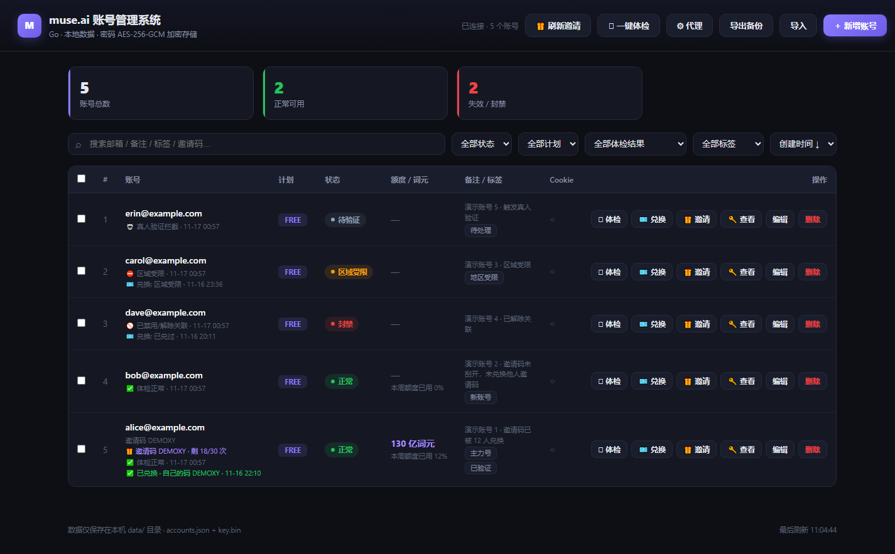
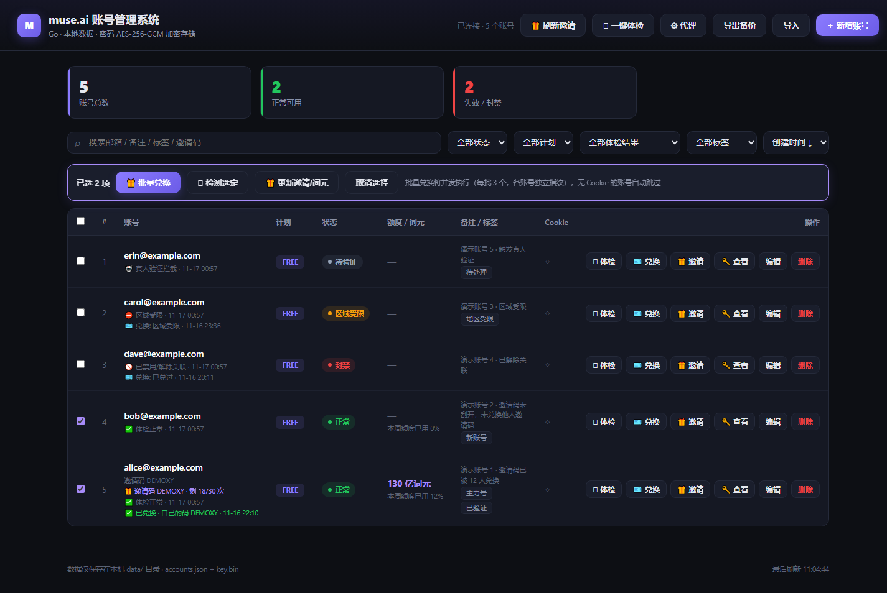
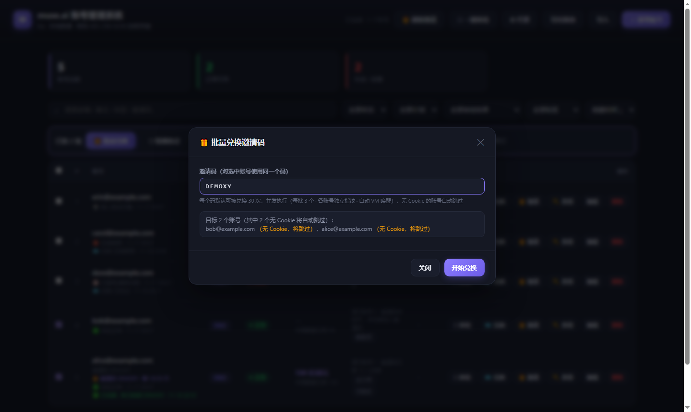
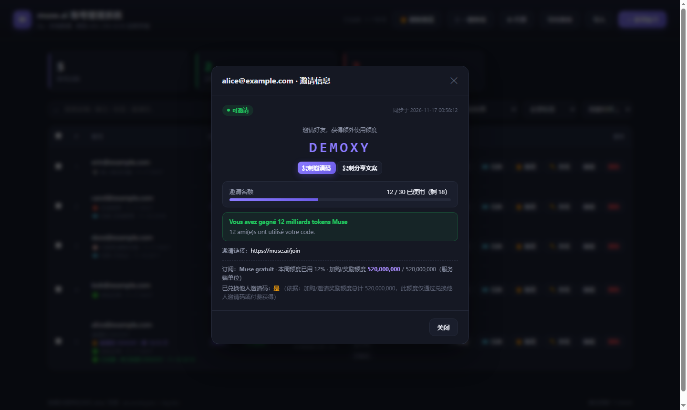
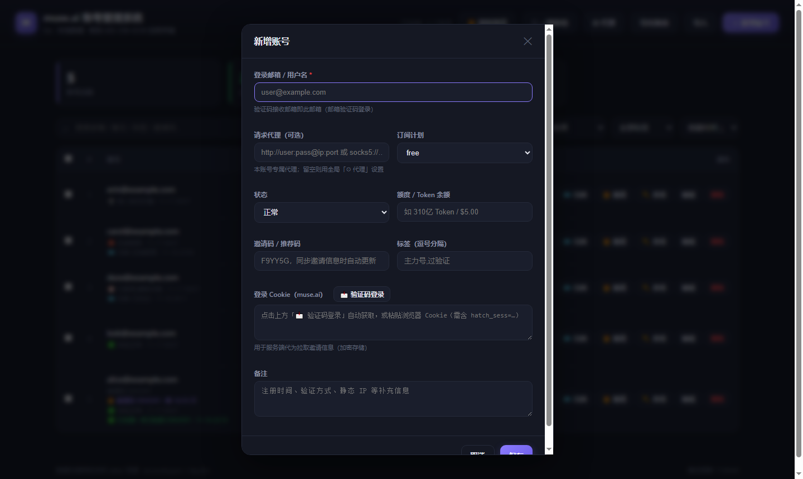

# muse-account-manager

muse.ai 账号管理器 —— 本地运行的 Web 工具（Go 单二进制，零第三方依赖）。

多账号的验证码登录、Cookie 加密管理、账号准入体检、邀请码刮取 / 批量兑换、订阅额度（词元）跟踪，全部在**本机**完成，数据不上传任何第三方。

> ⚠️ 本工具仅限个人管理自有账号使用。请遵守 muse.ai 服务条款；批量注册 / 规避风控等滥用行为不在本工具的设计目标内。

## 功能

- **账号台账**：邮箱验证码登录账号的集中管理；Cookie 以 AES-256-GCM 加密落盘（`data/key.bin` 主密钥）
- **验证码登录（服务端代请求）**：填邮箱 → 收码 → 自动执行 muse.ai 登录链（restart → send-otp → confirm-otp → [select-account] → save-account），自动写入 Cookie，无需浏览器
- **账号体检（准入状态）**：`auth/check` + 落地页 `vmState` 双信号，区分五种状态：
  - ✅ 正常（admitted · VM RUNNING）
  - 🚫 已禁用 / 解除关联（vmState=DISABLED，API 层不暴露该状态）
  - ⛔ 区域受限 / 等候名单（hatchAdmissionInvalidated）
  - 🤖 真人验证拦截（checkpoint_url）
  - ⌛ 登录失效 / ⚠️ 无法判定
- **邀请码管理**：
  - 首次「刮开」自动完成（GET 展示信息 → POST 生成 / 刷新实时计数）
  - 实时兑换次数（以 POST 实时数据为准，不做陈旧缓存）
  - **批量兑换**：同一码并发兑换多个选中账号（每批 3 个，每账号独立浏览器指纹防关联）
- **订阅 / 词元跟踪**：复刻站点 Server Action 查询订阅；`topupTotal > 0` 即「已兑换他人邀请码」的可靠判定；额度列直接换算显示当前词元（1 单位 = 25 词元）
- **一键体检 / 一键刷新邀请**：并发体检或刷新全部账号（或选定账号），汇总统计 + 逐账号明细
- **每账号独立请求头指纹**：以登录邮箱哈希派生稳定一致的 UA / sec-ch-ua / Accept-Language（同账号恒定、不同账号互异），避免多账号共用同一指纹被关联
- **代理支持**：账号级代理 > 全局设置 > `MUSE_PROXY` 环境变量；内置连通性测试
- **导入 / 导出**：JSON 备份（密文形态，可明文导出自行保管）

## 界面预览

| | |
|:---:|:---:|
| **账号台账总览** | **多选批量操作** |
|  |  |
| **批量兑换邀请码** | **邀请码详情** |
|  |  |

**新增账号（邮箱验证码登录）**



> 演示数据均为虚拟账号。

## 部署指南

### 1. 环境要求

- Windows 10+（x64）或 Linux x86_64 / arm64，单二进制免安装，无任何运行时依赖
- 现代浏览器（Chrome / Edge / Firefox）
- 访问 muse.ai 需要可用代理（HTTP 或 SOCKS5，国内网络直连通常不可达）

### 2. 获取程序

从 [Releases](../../releases) 下载对应平台文件，放入一个专门目录（程序会在同目录下自动创建 `data/`）：

| 文件 | 适用平台 |
|---|---|
| `muse-manager.exe` | Windows x64 |
| `muse-manager-linux-amd64` | Linux x86_64 |
| `muse-manager-linux-arm64` | Linux arm64（树莓派 / ARM 服务器等） |

也可以自行构建（见下方「构建」）。

### 3. 目录结构

```
muse-account-manager/
├── muse-manager.exe        # 主程序（Linux 为对应二进制）
├── 启动账号管理.bat         # Windows 一键启动
└── data/                   # 首次运行自动生成
    ├── accounts.json       # 账号库（敏感字段为 AES-256-GCM 密文）
    ├── key.bin             # 主密钥（首次运行自动生成）
    └── settings.json       # 全局设置（代理等）
```

全部数据都在 `data/` 一个目录内，复制即备份、删除即清空。

### 4. 首次启动

```bash
# Windows：双击 启动账号管理.bat，或
muse-manager.exe serve -open

# Linux
chmod +x muse-manager-linux-amd64
./muse-manager-linux-amd64 serve -open
```

`-open` 自动打开浏览器，或手动访问 <http://127.0.0.1:8787>。Ctrl+C 停止服务。

服务默认绑定 `127.0.0.1`（仅本机可访问）。常用参数：

| 参数 | 说明 |
|---|---|
| `-addr` | 监听地址，默认 `127.0.0.1:8787`（确需局域网访问可改 `0.0.0.0:8787`，并务必配合访问令牌） |
| `-data` | 数据目录，默认 `./data` |
| `-open` | 启动后自动打开浏览器 |

如需页面访问令牌（打开页面后需先登录）：

```bash
# Windows PowerShell
$env:MUSE_ACCESS_TOKEN='你的令牌'; .\muse-manager.exe serve
# Linux
MUSE_ACCESS_TOKEN=你的令牌 ./muse-manager-linux-amd64 serve
```

### 5. 配置代理

体检 / 邀请 / 登录等对 muse.ai 的请求需要代理。优先级：**账号代理 > 全局代理 > `MUSE_PROXY` 环境变量**。

推荐：启动后点右上角「⚙ 代理」→ 填入如 `socks5://127.0.0.1:10808` 或 `http://127.0.0.1:7890` → 测试连通 → 保存，立即生效无需重启。

```bash
# 或用环境变量（启动前设置）
MUSE_PROXY=socks5://127.0.0.1:10808 ./muse-manager-linux-amd64 serve
# 或用 CLI 写入全局设置
muse-manager set-proxy socks5://127.0.0.1:10808
```

### 6. 添加账号（邮箱验证码登录）

1. 点「➕ 新增账号」，填写登录邮箱（同时就是验证码接收邮箱）
2. 在「登录 Cookie」一栏旁点「📩 验证码登录」——工具向 muse.ai 请求发送验证码
3. 到邮箱查收 6 位验证码（注意垃圾箱），填入并确认；服务端自动执行完整登录链并回填 Cookie，无需浏览器
4. 按需补充：本账号专属代理（留空用全局）、订阅计划、标签、备注
5. 保存成功后自动执行账号体检 + 拉取邀请码/词元状态，并以汇总提示告知结果

> 已在浏览器登录过 muse.ai 的账号，也可以直接把 Cookie（需含 `hatch_sess=…`）粘贴到 Cookie 一栏。

### 7. 日常使用

- **🩺 一键体检**：并发体检全部账号（每批 3 个），完成后给出统计汇总与逐账号明细
- **🎁 刷新邀请**：并发刷新全部账号邀请状态（自动刮码、实时兑换次数、订阅/已兑换判定）
- 勾选账号后出现批量浮条：
  - **🩺 检测选定**：对选中账号执行体检 + 刷新邀请/词元
  - **🎁 批量兑换**：用同一邀请码并发兑换选中账号（每批 3 个、每账号独立指纹，无 Cookie 账号自动跳过）
  - **📋 复制邀请码 / ⬇️ 下载邀请码**：把选中账号的邀请码复制到剪贴板（每行：邮箱 + 码 + 剩余次数）或下载为 CSV 文件（含同步时间，UTF-8 BOM，Excel 直接打开）
- 「额度/词元」列直接显示当前词元余额与本周使用率（1 单位 = 25 词元）
- 支持按状态、体检结果、标签、计划组合筛选与搜索

### 8. 数据备份与迁移

- **整目录备份（推荐）**：复制整个 `data/`；恢复时放回程序同目录即可
- **界面导入/导出**：JSON 备份，默认密文形态
- **CLI**：

```bash
muse-manager export -out backup.json              # 导出（默认密文；-reveal 导出明文，务必妥善保管）
muse-manager import -in backup.json -mode merge   # merge=跳过重复 / replace=整体替换
```

换机迁移：把程序与 `data/` 一起复制到新机器直接运行。`accounts.json` 与 `key.bin` 必须成对——缺主密钥的密文无法解密。

### 9. 安全建议

- 保持默认 `127.0.0.1` 绑定，不要长期暴露公网；远程使用建议 SSH 隧道 + 访问令牌
- `key.bin` 与导出备份等同于账号凭据，勿外发、勿提交代码仓库
- 求助或分享截图前，确认画面不含真实邮箱、邀请码等敏感信息
- Cookie 即登录凭据：怀疑泄露时在 muse.ai 重新登录即可使旧 Cookie 失效

### 10. 常见问题排查

| 现象 | 原因与处理 |
|---|---|
| 页面打不开 | 确认访问 `http://127.0.0.1:8787`；端口占用时换 `-addr 127.0.0.1:8788`；确认服务进程仍在运行 |
| 所有请求超时 | 未配置代理或代理失效：「⚙ 代理」→ 测试连通；必要时更换代理出口 |
| 验证码收不到 | 查垃圾箱；核对邮箱；稍候点「📩 已发送，重新发送」 |
| 🤖 真人验证拦截 | muse.ai 风控触发：在浏览器登录该账号完成人机验证后重新体检 |
| ⛔ 区域受限 | 账号区域未开放准入（等候名单），与工具无关；可尝试更换代理出口地区 |
| ⌛ 登录失效 | Cookie 过期：重新走一遍「📩 验证码登录」 |
| 🎁 额度用尽 | 该账号邀请额度已用完（EXHAUSTED），无法继续刮码 |
| 🎁 403 Forbidden | 多为 muse.ai 风控或区域限制，更换代理出口后重试 |
| 「已兑换他人邀请码」如何判定 | 以订阅数据 `topupTotal > 0` 为准（邀请奖励只来自兑换他人码或付费），比邀请接口的 `has_redeemed_invite_code` 字段可靠 |
| key.bin 丢失 | 已加密 Cookie 无法解密，只能逐个重新验证码登录恢复；请日常备份整个 `data/` |
| 导入后解密失败 | 密文备份须与原 `key.bin` 配对；跨机器导入请用明文导出文件（导入时自动重新加密） |

## 安全设计

- Cookie 等敏感字段全部 AES-256-GCM 加密，主密钥可用 `MUSE_MASTER_KEY` 环境变量指定（缺省自动生成 `data/key.bin`）
- 服务默认仅绑定 `127.0.0.1`；设置 `MUSE_ACCESS_TOKEN` 环境变量可开启访问令牌鉴权
- 数据原子写入（临时文件 + rename），密码学随机源失败时拒绝降级为明文
- 出站请求复刻浏览器特征头（Sec-Fetch-* / sec-ch-ua / CSRF token），带两级 CSRF 自动重试

## CLI

```
muse-manager serve     [-addr 127.0.0.1:8787] [-data data] [-open]
muse-manager add       -email a@b.c [-plan free] [-status active] [-tags 标签1,标签2] [-notes …]
muse-manager list      [-data data]
muse-manager show      <ID或邮箱关键词> [-data data] [-reveal]
muse-manager invite    <ID或邮箱关键词> [-data data]          # 拉取邀请信息（需先录入 Cookie）
muse-manager check     <ID或邮箱关键词> [-data data]          # 准入体检
muse-manager redeem    <ID或邮箱关键词> <邀请码> [-data data]  # 兑换（自动 VM 唤醒）
muse-manager login     <邮箱> [-code 123456] [-proxy url] [-data data] [-save]
muse-manager set-proxy socks5://… [-data data]                # 不带参数=清除
muse-manager delete    <ID> [-data data] [-f]
muse-manager export    [-data data] [-out backup.json] [-reveal]
muse-manager import    -in backup.json [-data data] [-mode merge]
```

环境变量：`MUSE_ACCESS_TOKEN`（Web 访问令牌）· `MUSE_MASTER_KEY`（主密钥，缺省自动生成 `data/key.bin`）· `MUSE_PROXY`（默认代理）。

## 构建

```bash
# Windows
go build -trimpath -ldflags '-s -w' -o muse-manager.exe .
# Linux x86_64
GOOS=linux GOARCH=amd64 CGO_ENABLED=0 go build -trimpath -ldflags '-s -w' -o muse-manager-linux-amd64 .
# Linux arm64
GOOS=linux GOARCH=arm64 CGO_ENABLED=0 go build -trimpath -ldflags '-s -w' -o muse-manager-linux-arm64 .
```

Go ≥ 1.22，纯标准库，无第三方依赖。

## License

MIT

> AI生成
